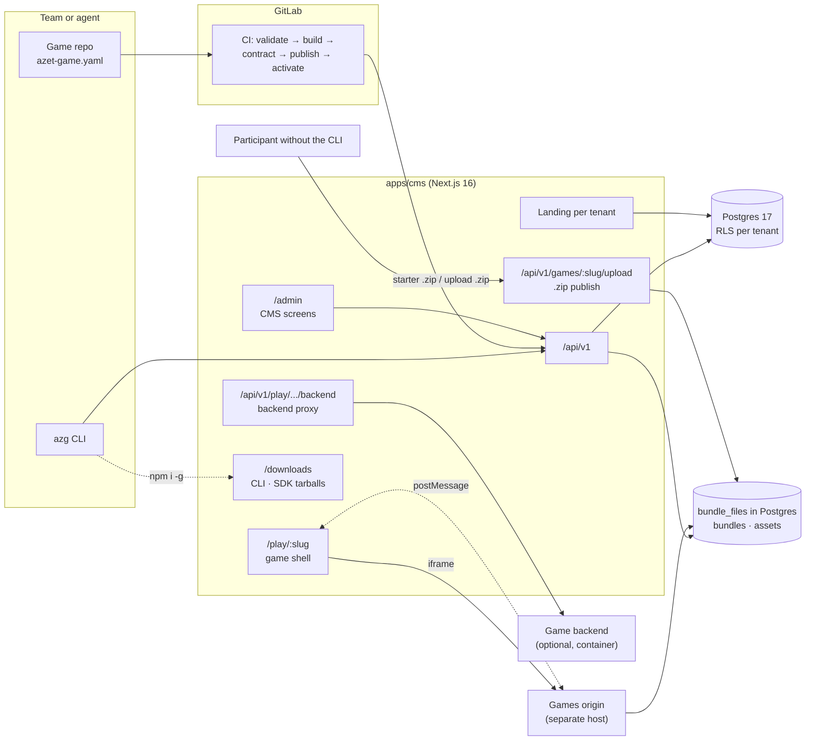
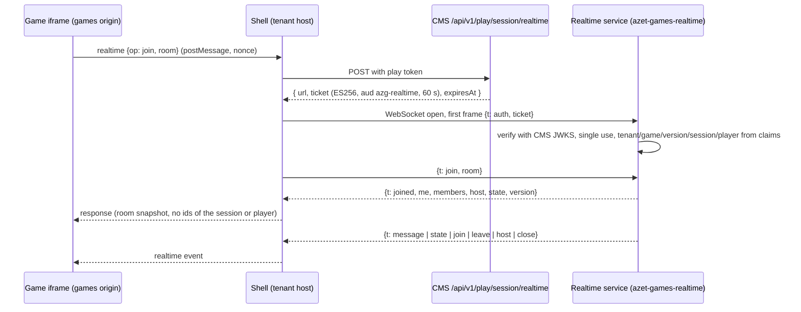

# Architecture

Azet Games CMS v1 is one Next.js application backed by Postgres, which also stores the game bundles and assets (`bundle_files`, D-30); there is no object storage. Games are static bundles served from a separate origin and run inside a sandboxed iframe. Everything the CMS UI does goes through the same REST API that the CLI, CI and agents use.

## 1. Components

| Component | Where | Responsibility |
|---|---|---|
| `apps/cms` | Next.js 16 App Router, React 19, styled-components 6 | Admin UI, public API, landing pages, game shell, backend proxy |
| `packages/manifest` | TypeScript, Ajv | Manifest schema, validation and defaults. Runs in Node and the browser |
| `packages/sdk` | TypeScript, no runtime dependencies | Game side of the shell protocol (`@azet/games-sdk`) |
| `packages/shell` | TypeScript, plain DOM | Shell UI, protocol host, motivation rules, in-memory adapter (`@azet/games-shell`). Used by the CMS `/play` page and by `azg dev` |
| `packages/server` | TypeScript, `jose` | Verifies signed player tokens in game backends (`@azet/games-server`) |
| `packages/realtime`, `apps/realtime` | TypeScript; Node 22 + `ws` | Room engine and the realtime WebSocket service (`game.realtime`, [§11](#11-realtime-service)) |
| `packages/cli` | TypeScript, Node 22+ | `azg` command (`@azet/games-cli`) |
| `game-templates/*` | Vite + TypeScript; `html` without a build | Game starters (`html`, `vanilla-ts`, `react`, `vue`, `phaser`, `pixi`; list in `GAME_TEMPLATES`, packages/manifest) with the SDK, manifest and CI include; each passes `azg contract`. `html` ships the SDK as one file and `AI-PROMPT.md` (D-35). Pixi needs `import 'pixi.js/unsafe-eval'` because the games origin CSP forbids `eval()` |
| `scripts/pack-packages.mjs` | esbuild + `npm pack` | Builds `@azet/games-sdk`, `-server` and the bundled `-cli` into tarballs that the CMS serves under `/downloads` (D-34); run in the Docker build |
| Upload and starter (`server/services/bundle-zip.ts`, `upload.ts`, `starter.ts`) | fflate | .zip in → same checks and services as `azg publish` → immutable version; starter .zip out (REG-7, REG-8) |
| `ci/game.yml` | GitLab CI | Pipeline included by every game repo |
| Postgres 17 | Docker locally, managed DB later | All CMS data, events, key-value store |
| Bundle storage (`server/storage.ts`) | Postgres table `bundle_files` in the cluster (`BUNDLE_STORAGE=postgres`, D-30); local disk (`.azg/bundles`) by default locally | Immutable game bundles under `/<tenant>/<slug>/<version>/`, game assets, badge icons and external-game covers. CI and the CLI publish through the API (`azg publish`), never to the storage directly. Object storage may replace the table later behind the same interface (Q-07) |

## 2. Routes

| Route | Who | What |
|---|---|---|
| `/admin/**` | Members (session) | CMS screens |
| `/api/v1/**` | Session or bearer token | REST API ([API.md](api.md)) |
| `/` and `/<section>` on a tenant host | Public | Tenant landing page |
| `/play/<slug>` on a tenant host | Public | Game shell |
| `/turnaj/<slug>`, `/sezona/<season>` on a tenant host | Public | Tournament and season pages (TRN-2, TRN-4) |
| `/embed.js` | Public | Embeddable game block loader |
| `/api/health` | Infra | Health check with build SHA (same convention as Koktejl) |

**Tenant resolution for public pages:** by host (`hry.azet.sk` → `azet`, `hry-hackathon.azet.sk` → `azet-hackathon`). Locally, `/t/<tenant>/...` is rewritten by middleware so that one dev server can serve every tenant.

## 3. Game shell and sandbox

1. The shell page loads the game's active version manifest and the tenant + game configuration.
2. It renders the loading screen and an `<iframe sandbox="allow-scripts allow-pointer-lock" allow="fullscreen; autoplay; clipboard-write; accelerometer; gyroscope">` (`clipboard-write` since v1.21.0: a game copies an invite code on a tap; `accelerometer` and `gyroscope` since v1.29.0 for tilt controls, SNS-1; the embed script passes them on too) pointing at the games origin (`https://games.<domain>/<tenant>/<slug>/<version>/index.html`, locally a separate port).
3. Without `allow-same-origin` the game runs on an opaque origin: no cookies, no `localStorage`, no access to the parent page. Persistence goes through `game.store`.
4. Shell and game talk through `postMessage` ([SDK-CONTRACT.md](sdk-contract.md)). The shell accepts messages only from its own iframe's `contentWindow` and only after a handshake carrying a per-session nonce.
5. Network access from the game is limited by the CSP the games origin sends (`connect-src` = the games origin + the game's allowlist; `frame-ancestors` = shell origins, plus the article origins configured for the bundle's tenant so an embedded game (SHL-6) can load inside an article, D-40). Calls to the game backend go through the shell (`game.api.fetch`) and the CMS proxy, which attaches the signed player token. Realtime multiplayer (`game.realtime`) also goes through the shell, which holds the WebSocket to the realtime service, so `connect-src` stays unchanged ([§11](#11-realtime-service), D-77).
6. **Fast files (PERF-1, D-102).** `/files` keeps what it served in the pod's memory (192 MB LRU, 10 minutes; a write or delete in the pod forgets it), sends text brotli or gzip by `Accept-Encoding`, and answers `?w=160|320|640|960|1280` of a PNG, JPEG or WebP with a WebP copy made by `sharp` (`apps/cms/server/file-delivery.ts`); the landing and the shell use the copies through `srcset` (`imageSrcSet`, packages/shell).
7. **The games origin must send `Access-Control-Allow-Origin: *`.** A sandboxed game has an opaque origin, so every request carries `Origin: null`, and module scripts (Vite output) are CORS requests. Without the header the game does not load. The exact header set is in `packages/shell/src/headers.ts` (`gameOriginHeaders`); the production ingress/CDN must send the same.

**Builder preview (GAM-10.3, GAM-12, D-51).** `mountShell(container, { …, preview: { screen, sample, onPick } })` mounts the real shell for the CMS builder; public pages never pass `preview`, so their DOM and behaviour are unchanged. Host-side only, the SDK protocol does not change.

- `controller.preview(screen, sample?)` shows `loading` (held, no timer, no game load), `start`, `end` (sample score, streak, percentile, a new badge and the share button; `PREVIEW_SAMPLE` overridable per call), `error` (`controller.preview('error', { reason })`, default `load`; shows what a player sees, Retry never acts) or `playing`. The game iframe loads on the first `playing` and stays paused behind the other screens; switching never remounts it. A real failure of that game shows the error screen whatever screen is held, always with a Retry that reloads the game (the editor may have fixed it).
- `controller.update({ screens, messages, game, share })` re-renders the shell copy live; `setTheme` / `setSettings` update theme and settings without a reload.
- Per-game assets (THM-2, D-53): the shell game info carries `iconUrl` (the uploaded icon when set, else the manifest icon; game objects of the API resolve the same `iconUrl`/`coverUrl` from the active version, else the newest upload, ART-1) and the optional `coverUrl` and `loadingBackgroundUrl` (games origin URLs; absent or `null` without one). The loading screen draws the background cover-fit as an `` under a theme-coloured scrim; the start screen shows the cover, otherwise the icon. `controller.update({ game })` swaps them live. An older shell ignores the new fields.
- Badge icons (BDG-6, BDG-7): a badge on the end screen (`AwardedBadge` of the completion result, `NewBadge` of `PreviewSample.badges`) carries an optional `description` and `iconUrl`. The "Nový odznak" card shows the icon, otherwise a star in the accent colour, and the description under the title; an icon that cannot be loaded or decoded is replaced by the badge's initial in the accent circle (never a broken image). A game badge icon is served from the bundle at `__azg/badges/<id>.<ext>`, where both `azg publish` and the zip upload (REG-7.1) put it; the whole card is `end.badge`. The builder passes the focused badge with its effective values (tenant override, else manifest) as `controller.preview('end', { badges: [badge] })`. `azg dev` lists the declared badges with their icons, texts and how they are awarded in its side panel. An older shell ignores the new fields.
- Look of the shell screens (SHL-2.2, AUTH-4.1, D-73): `SHELL_CSS` uses only the `--azg-*` theme variables and values derived from `--azg-text` (`--azg-line`, `--azg-line-subtle`, `--azg-chip`), so the tenant template (light, dark, Halloween) decides every colour. The font of the shell's own screens is `--azg-shell-font` when the page sets it (the CMS play and embed pages and the builder preview set the games pages' Rethink Sans, `lib/play/shell-font.ts`), else the theme font; the game iframe keeps the theme font. The end screen groups its parts: notices, challenge, the score hero (`.azg-hero`, with the percentile), the `.azg-stats` grid (streak, daily challenge, weekly board), badges, tournament, links, login, prompts, then `.azg-actions`. The configured end sections keep their `end.section.<index>` keys and their order inside their group.
- The game's window (WIN-2, D-94): `mountShell` puts a `.azg-stage` (a size container that fills the host's box) around `.azg-shell` and draws the shell as the window of `ShellGameInfo.window` (`{ desktop, mobile }`, each `{ width: px | 'full', ratio: W/H | null }`, from `resolveWindow(manifest.window)`; default `DEFAULT_SHELL_WINDOW`, the 560 px column): custom properties `--azg-win-dw/dr/mw/mr` and `data-desktop` / `data-mobile` (`free` | `fixed`) on the stage, and a container query (≤ 640 px wide or ≤ 500 px high) picks the mobile side. „← Späť na hry“ is a child of the stage (top left), which also mirrors `data-state`. `ShellGameInfo.howTo` renders `section.azg-howto` on the start and pause screens (HOW-2); a line `{ text, imageUrl }` gets its picture (HOW-3). `ShellGameInfo.pauseButton: false` hides `.azg-pause-btn`, and the host's `pause_request` (`game.pause()`) runs the same pause as the button (PSE-1). `/embed.js` embeds the declared windows of the tenant's live games (`embedWindows`; hidden ones stay unlisted, a failing query gives none) and sizes each article box before the iframe loads, choosing the side by the shell's rule (≤ 640 px wide or ≤ 500 px high) (WIN-3).
- Hub games (HUB-2, HUB-3, D-92): with `endScreen: 'compact'` in `ShellGameInfo` (from the manifest) `onComplete` shows `button.azg-result` over the running game instead of the end overlay (4 s, a tap closes it) and calls `ProtocolHost.start(true)`: the next play opens with a `start` event but no `replay`, and `recordAbandon` skips it; `endScreen: 'none'` (HUB-7) does the same without the card; `backButton: false` (BCK-1) marks the arrow `data-while-playing="off"` so it hides while playing. In every game the host posts `result` (`playResult()` of the completion: score, points, earned, rejected, practice, badges, daily challenge, tournament rank; never a key, a session or a prompt) before `onComplete`.
- „← Späť na hry“ (SHL-1.1): rendered from the `homeUrl` mount option, as `a.azg-back` in the shell header (start, pause, playing) and `a.azg-home` under the end screen actions; `target="_top"`, or `_blank` with `rel="noopener"` when the shell runs in another page's frame (SHL-6). The click records `back_click`; no confirmation. Without a safe `homeUrl` (the `azg dev` shell) there is no back control; the builder preview shows it with `#` and never navigates.
- Player login (AUTH, AZG-15): `PreviewSample.player` decides the signed-in variant. With a player the start and end screens show the signed-in chip (the nickname and „Odhlásiť", a `POST` to the `logoutUrl` mount option); without one they show „Prihlásiť sa cez Azet" (a link to the `loginUrl` mount option). Public pages take the player from `init.player`. A signed-in player never gets the LBD-5.3 nickname field. Host-side only, the SDK protocol does not change.
- Click-to-edit: in preview mode editable elements carry `data-azg-edit="<key>"` with a hover outline (`loading.text`, `loading.logo`, `start.title`, `start.rules`, `start.button`, `end.section.<index>`, `end.badge`, `end.share`, `theme.accent`, `theme.icon`, `theme.cover`, `theme.loadingBackground`). A click on the loading, start or end screen never acts; it calls `onPick(key)` for an editable element.
- `shellDefaults(game, messages?)` returns what players get for an empty field (shell copy, game name, manifest description, `DEFAULT_END_SECTIONS`) so the builder shows them as placeholders (GAM-12.2).
- The preview runs on `MemoryAdapter`: it never creates sessions, plays or events.

**Shell error screen (ERR-2).** Every failure ends on one error screen in the shell style with Slovak copy (`packages/shell/src/messages.ts`); the game frame is never left blank. `failureReason()` maps the failure to a `reason`, `errorCopy()` gives its copy:

| `reason` | When | Retry |
|---|---|---|
| `load` | the game page never says `hello` within 10 s (bundle missing, games origin down) | yes |
| `timeout` | `hello` but no `ready()` within 10 s (SDK-2.1) | yes |
| `offline` | any failure while `navigator.onLine` is false | yes |
| `forbidden` | session refused with `403` (e.g. a preview version on a production tenant) | no, link to `homeUrl` |
| `not_found` | session refused with `404` (game switched off or unknown) | no, link to `homeUrl` |
| `rate_limited` | session refused with `429` | yes |
| `session` | any other session or completion failure | yes |
| `unsupported` | the game speaks a newer protocol | no, link to `homeUrl` |
| `crash` | the game crashed | yes |

The shell reads the HTTP status from a numeric `status` on the error the adapter throws; the CMS `HttpAdapter` sets it. `leaderboardUrl` (mount option) is the public leaderboard page the weekly-rank card links to (LBD-5.6). `homeUrl` (mount option) is the tenant landing; without it the no-retry screens show no link. The error screen carries `data-reason="<reason>"`. Host-side only: the SDK protocol does not change.

## 4. Data model

All tenant-owned tables have `tenant_id` and an RLS policy `tenant_id = current_setting('app.tenant_id')::uuid`, with `FORCE ROW LEVEL SECURITY` so even the schema owner is filtered. The application connects as `azg_app` (no `BYPASSRLS`). Every request runs in a transaction that sets `app.tenant_id` first. A missing setting matches no rows.

Three roles: `azg_owner` owns the schema and runs migrations; `azg_app` is what the CMS connects as; `azg_definer` (`NOLOGIN BYPASSRLS`) owns only the `SECURITY DEFINER` auth lookups (`auth_token_by_hash`, `auth_touch_token`, `auth_user_memberships`) that must work before the tenant is known.

| Table | Key columns | Notes |
|---|---|---|
| `tenants` | `id`, `slug`, `name`, `hosts[]`, `kind` (`production`/`sandbox`) | Not tenant-scoped. Readable by superadmins only |
| `users` | `id`, `email`, `name`, `password_hash`, `azet_player_key`, `azet_linked_at`, `azet_link_nonce`, `azet_link_pending` | Global (no tenant); the scrypt hash of a personal password (MEM-5, never returned); the player key of the person's linked Azet account (unique) and the nonce and held key of their one open link request (LNK-1, D-88) |
| `team_invites` | `tenant_id`, `team`, `version` | A team and the version of its invite link (MEM-3) |
| `memberships` | `tenant_id`, `user_id`, `role` (`viewer`/`team`/`product`/`admin`), `team` | Team members can edit only their team's games |
| `api_tokens` | `tenant_id`, `name`, `hash`, `prefix`, `scopes[]`, `game_ids[]`, `kind` (`user`/`agent`/`deploy`), `expires_at`, `last_used_at` | Token value shown once; stored as SHA-256 |
| `device_codes` | `user_code`, `device_code_hash`, `user_id`, `tenant_id`, `expires_at` | CLI login |
| `games` | `tenant_id`, `slug`, `name`, `team`, `status`, `active_version_id`, `settings`, `screens`, `motivation`, `access`, `theme`, `live_from`, `live_until`, `repo_url`, `promoted_from` | One row per game per tenant |
| `game_versions` | `game_id`, `version`, `kind` (`release`/`preview`), `ref`, `commit_sha`, `manifest`, `bundle_prefix`, `created_by` | Immutable |
| `game_backends` | `game_id`, `version_id`, `url`, `db_schema`, `status` | Level 2 backends |
| `themes` | `tenant_id`, `draft`, `published`, `published_at` | Tenant appearance |
| `landing_pages` | `tenant_id`, `draft`, `published`, `published_at` | Sections and tiles |
| `players` | `tenant_id`, `player_key` (hashed Azet ID or anonymous ID), `nickname`, `consent`, `deleted_at` | |
| `play_sessions` | `tenant_id`, `game_id`, `version_id`, `player_key`, `logged_in`, `nonce` | One row per shell load (handshake) |
| `plays` | `tenant_id`, `session_id`, `game_id`, `player_key`, `player_kind`, `play_date`, `started_at`, `completed_at`, `score`, `points`, `time_seconds`, `success`, `rejected` | One row per start → complete ("Play again" adds a row). `player_kind` (`signed_in` / `nickname` / `anonymous`, EVT-3) is set at start and updated at completion |
| `streaks` | `tenant_id`, `player_key`, `scope` (`shared`/game id), `current`, `best`, `last_date` | |
| `events` | `tenant_id`, `game_id`, `version_id`, `session_id`, `player_key`, `player_kind`, `play_date`, `type`, `payload`, `ts` | Append-only; source for DTM export and the player timeline. Only catalog types, cleaned by the server (EVENTS.md, EVT-2). Indexed by game and time and by player and time |
| `stats_daily` | `tenant_id`, `game_id` (null = tenant), `day`, `kind` (`all` / player kind), counts, sums, D1/D7/D30 cohorts, player bitmaps | Nightly rollup (D-42, D-57); `stats_players` holds the bit index of each player |
| `stats_funnel_daily` | `tenant_id`, `game_id`, `day`, `sessions`, `loaded`, `started`, `completed`, `shared_or_replayed` | Funnel per game and day (EVT-4.2) |
| `stats_events_daily` | `tenant_id`, `game_id`, `day`, `type`, `name`, `events`, `sessions` | Events per type and custom name (EVT-4.3) |
| `kv_store` | `tenant_id`, `game_id`, `scope` (`player`/`shared`), `player_key`, `key`, `value`, `updated_at` | Level 1 backend; size quota per game |
| `proposals` | `tenant_id`, `author`, `diff`, `status`, `decided_by`, `decided_at` | Agent changes in production tenants |
| `audit_log` | `tenant_id`, `actor`, `action`, `target`, `before`, `after`, `ts` | Every write |
| `deny_words` | `tenant_id`, `word` | Nickname filter |
| `tournaments` | `tenant_id`, `slug`, `game_ids[]`, `starts_at`, `ends_at`, `metric`, `aggregation`, `eligibility`, `prizes`, `season`, `published`, `frozen_at`, `confirmed_at` | TRN-1; ranked as an event board (D-44, D-62) |
| `tournament_results` | `tenant_id`, `tournament_id`, `rank`, `player_key`, `value`, `member` | The frozen ranking at the end (TRN-3), with the member's name for players who were members then (LNK-2, no prize); removed by the DAT-4 delete |
| `matches` | `tenant_id`, `game_id`, `version_id`, `kind` (`invite`/`quick`), `code`, `players`, `status`, `turn`, `state`, `version`, `turn_seconds`, `turn_deadline`, `expires_at`, `end_reason`, `created_by` | Asynchronous turn-based matches (MAT, D-82); the invite code is unique among a game's open matches |
| `match_members` | `tenant_id`, `match_id`, `game_id`, `seat`, `player_key`, `session_id`, `outcome`, `score`, `points`, `result_session_id`, `result_shown_in` | One seat per player; the result is recorded in a play session of its own (MAT-5); the DAT-4 delete replaces the player key with a tombstone |
| `device_merges` | `tenant_id`, `device_key`, `account_key`, `moved`, `merged_at` | MRG-1: a device whose wallet, items and saves moved to an account at login; one row per device, the account side caps one move a day (D-93) |

ORM: Drizzle (TypeScript schema, SQL migrations in `apps/cms/db/migrations`).

## 5. Identity

- **CMS users:** NextAuth (as in other Azet apps). Until Okta: e-mail + personal password, or the shared access code for people without a password yet, who must then set one (MEM-5, D-75); a dev provider locally. A person of an e-mail domain that a sandbox tenant lists joins it on sign-in (`auth_auto_join_tenants`, MEM-1); a team member without a team chooses one before the admin opens (MEM-2).
- **CMS users and their Azet account (LNK, D-88):** the CMS sign-in is never Azet. A signed-in person links their own Azet account: `POST /api/v1/account/azet` makes a signed request (10 minutes, one tenant, single use through `users.azet_link_nonce`), `/auth/link` on the tenant host runs the normal Azet login with it in the login state, and the callback holds the player key (`users.azet_link_pending`) and sends a signed proof back to the same browser; the person's own CMS session confirms it (`POST /api/v1/account/azet/confirm`), so a link request sent to someone else links nothing. A player whose key a member of the tenant linked is that tenant's member („Team“ in the admin, no tournament prizes); memberships are row-level secured, so this holds per tenant.
- **CMS people on sandbox games (CML, D-91):** on a sandbox tenant `/auth/cms` keeps a random state in a signed cookie on the tenant host and sends the browser to `/admin/player-login` on the CMS host; for a member of the tenant the CMS answers with a 2-minute ticket bound to that state and to a nonce on the person (`users.cms_login_nonce`), and `/auth/cms-callback` uses the nonce up on its first try, sets the normal player session and clears the state. The player key is the linked Azet account's, else `users.cms_player_key` (the Azet HMAC over `cms-member:<user id>`). Production tenants keep Azet ID only.
- **CLI and agents:** bearer tokens (`azg_` + 32 random bytes, base62). People get one through the device flow (`azg login`), agents get one created in the CMS (Tokens screen) and stored in Vault.
- **Players:** an `IdentityProvider` adapter. `fake` locally (pick a test player in the dev toolbar), `azet` when `AZET_OAUTH_*` is set (Azet OAuth code + PKCE on the tenant host, `/auth/login`, `/auth/callback`, `POST /auth/logout`; the player key is the HMAC of the Azet `idUser`, same HMAC space as DTM `userstats.iduser`; D-56). Anonymous players get a random ID in a first-party cookie on the shell host and can play but are excluded from leaderboards.
- **A device moves to the account at login (MRG-1, D-93):** the Azet and CMS-account callbacks call `mergeDeviceAtLogin` (`server/services/device-merge.ts`) with the browser's `azg_anon` key; in one transaction the wallet and items (`mergeDeviceWallet`, ledger `merge`) and the `kv_store` player keys the account lacks move over, capped by the account's limits and one `dailyEarnCap` per currency; a device stays with the account of its first move, an account takes one move a day (advisory locks on the account, then the device). `mergeOnLogin` waits at most 3 s; a failure is logged and never fails the login. The Azet login state cookie is `__Host-azg_login` on https.

## 6. Game backends

| Level | Mechanism | Isolation |
|---|---|---|
| 1. SDK store | `kv_store` table through `/api/v1/play/.../store` | RLS per tenant + game id from the play session + player key from the session |
| 2. Own backend | Container from `backend/`, reached through `/api/v1/play/<slug>/backend/*` | Own Postgres schema and user; signed player token; resource quota |

The proxy (`POST /api/v1/play/session/backend` with `{ path, method, headers, body }`) adds `Authorization: Bearer <player token>`: a short-lived (5 min) ES256 JWT, `iss=azet-games-cms`, `aud=game:<tenant>/<slug>`, `sub=<player key>`, with `tenant`, `game`, `version`, `session`, `loggedIn`, `nickname`. `@azet/games-server` verifies it with the CMS public key (`/api/v1/.well-known/jwks.json`). Locally the signing key is generated once into `.azg/keys/`; production reads `PLAYER_TOKEN_PRIVATE_KEY`.

**Locally**, `azg dev --backend` runs `backend/` with Node on the host and a throwaway Postgres in Docker; the dev shell reaches it through a same-origin proxy (`/__azg/backend`) with the same request/response shape as the CMS proxy, so there is no CORS difference between dev and production. To play a backend game through the local CMS, run the backend and register it with `azg backend set-url <slug> http://localhost:<port>`.

**Backend URLs are an SSRF risk**, so registration only accepts URLs matching `BACKEND_URL_PATTERN` (dev default: localhost/127.0.0.1; production default: `http://azgb-<tenant>-<slug>.rin-apps.svc.cluster.local[:port]`), the proxy re-checks it on every call, refuses paths that change the origin, never forwards the game's cookies or Authorization header, and drops `Set-Cookie` from responses.

**After the move**, CI builds the image and ArgoCD deploys it into the tenant namespace in `rin-apps`; Postgres schemas are created by a bootstrap job.

## 7. CI/CD flow

1. `validate`: `azg validate` (manifest + SDK version + assets).
2. `build`: `npm ci && npm run build` → `dist/`.
3. `contract`: headless Chromium runs `dist/` inside the real shell (`azg contract`).
4. `budget`: bundle size and Lighthouse (warning in sandbox tenants).
5. `publish`: `azg publish` uploads `dist/` to `/<tenant>/<slug>/<version>/` and creates the `game_versions` row. Version = `package.json` version + `-<short sha>` on branches.
6. `activate` (default branch only): sets `active_version_id` in sandbox tenants. Production tenants are never activated by CI.

The deploy token is a `deploy` kind token scoped to one game with `versions:write` (+ `versions:activate` in sandbox tenants).

## 8. Promotion

`POST /api/v1/games/<slug>/promote {"to": "azet"}` (product role in both tenants):

1. Copies the game row (settings, screens, theme) into the target tenant as `draft` with `promoted_from`.
2. Copies the active version's bundle to the target prefix and creates a `release` version.
3. Does not copy players, sessions, scores or store data.
4. Creating a deploy token for the target tenant requires an admin after code review.

## 9. Security summary

| Threat | Control |
|---|---|
| Cross-tenant reads (the Puzzlr `tenantConfig.list` class of bug) | Tenant from session/token only; RLS; no list-tenants endpoint; tests per endpoint |
| Malicious or buggy game code | Opaque-origin sandboxed iframe; CSP; no cookies; contract test |
| Leaked deploy token | Scoped to one game; cannot activate production; expires; revocable |
| Agent changes production | Agent tokens in production tenants create proposals only |
| Score tampering | Server-side checks against manifest limits and minimum play time; backends can report authoritative results |
| Secrets in config | Config schemas reject secret-looking keys; secrets only in Vault / `.env` |
| XSS through CMS-configured links | End-screen targets validated (`https://` for articles, slugs for games) and re-checked in the shell (`isSafeHref`); all CMS text via `textContent`. **Production must serve public pages (`/t/**`, tenant hosts) from a different host than the CMS admin** so a public-page bug can never ride an admin session (Q-10) |
| Stale or escalated personal tokens | `user` tokens re-check membership, role and team on every request; removed members lose access immediately |
| Agents escaping approval | Agents in production tenants cannot mint tokens, register games, manage members or delete player data; game-limited callers can only mint tokens for their games and cannot read tenant-wide data (audit, proposals, export, members) |
| Cross-tenant backend calls | Backend URLs must match the caller's own tenant prefix (`azgb-<tenant>-` in rin-apps; NetworkPolicy lets only the CMS reach a backend); `@azet/games-server` refuses to start without `AZG_TENANT`/`AZG_GAME` (audience check) and rejects tokens older than 10 min |
| Rate-limit bypass | `X-Forwarded-For` is trusted only with `TRUST_PROXY=1` (behind the ingress), using the hop the ingress added |
| A game abusing realtime (stealing tickets, flooding rooms, reading other games' rooms) | The shell holds the WebSocket and the ticket, the game only sees room data (D-77); tickets are single use, 60 s and `aud: azg-realtime`; rooms are namespaced by tenant and game from the ticket; per-connection and per-room rate limits (RTM-7); no player key, session or ticket in any frame to a client (RTM-3.4) |
| Nickname abuse | Deny list; anonymous display option |
| Personal data in analytics | The server strips a deny list of personal-data keys from every event (EVT-2.2); the admin addresses players by a reference derived from the hashed key and never shows the key or an Azet ID; every player detail and timeline read is audited (PLY-2.1, PLY-2.2) |

## 10. Local development

`docker compose up -d` starts Postgres 17 on port **5433** (5432 is often taken by a local Postgres). The CMS runs on 3000. Game bundles are stored on disk (`.azg/bundles`) and served from a separate origin with the production header set. MinIO was dropped: its community Docker images are no longer published.

`azg dev` runs a game without the CMS: the shell on `http://localhost:5170` and the game on `http://127.0.0.1:5171` (a different origin), or the game's own Vite dev server with `--game-url`.

## 11. Realtime service

Realtime multiplayer (PRD §5.31 RTM, D-77, D-78): one service for every game, so teams do not run their own WebSocket backends.

| Part | Where | Owner (stage 2) | Responsibility |
|---|---|---|---|
| Room engine | `packages/realtime` (`@azet/games-realtime`), TypeScript, no I/O | Dev CMS | Rooms keyed by tenant + game + room id, quick-match queues keyed by tenant + game + version + players, presence, host hand-over, merge-patch state with `version` and `ifVersion`, every RTM-7 limit, the wire frame types. Used by the service, `azg dev` and the tests |
| Service | `apps/realtime`, Node 22 + `ws` | Dev CMS | WebSocket server on port 3010: ticket check (`jose`, CMS JWKS, `jti` kept until expiry), heartbeat, reconnect grace, graceful shutdown (`close` reason `restart` on SIGTERM), `GET /health` → `{ status, sha, rooms, connections }`, `GET /ready` (JWKS loaded), `GET /metrics` (Prometheus), `GET /admin/rooms` and `POST /admin/rooms/close` for the CMS's Multiplayer tab (RTM-15: a CMS-signed admin ticket, ES256, `aud: azg-realtime-admin`, 60 s, single use, naming one tenant and game and `scope` `read` or `write`; the CMS calls it inside the cluster through `REALTIME_ADMIN_URL`), JSON logs without personal data (RTM-9.4); chart and settings in DEPLOY.md "Realtime service" |
| Ticket endpoint | `POST /api/v1/play/session/realtime` (CMS) | Dev CMS | Play token → ticket; checks the tenant kind and the player's moderation state (RTM-3); a version without a `realtime:` block gets a presence-only ticket (`rooms: false`, RTM-18); signs the player's profile (PRS-2) and `realtime.bots` (BOT-1) |
| Shell transport | `packages/shell` | Dev Platform | One WebSocket per session, opened on the first `join`/`quickMatch`, closed on leave, unload, crash or error screen; maps game messages to frames and frames to events; `room_join`/`room_leave` events |
| SDK | `packages/sdk` (`game.realtime`) | Dev Platform | The API of SDK-CONTRACT "Realtime multiplayer" |
| Dev and preview | `azg dev` (engine on the dev shell origin, `/__azg/realtime`), `MemoryAdapter` (one-tab room) | Dev Platform | RTM-10 |
| Referee (REF, D-81) | `POST /api/v1/realtime/referee` (CMS), `createReferee` (`@azet/games-server`), `azg_referee.py` (Python template) | Dev CMS | A game with `realtime.authority: referee`: its backend trades the game token for a referee ticket (ES256, `aud azg-realtime`, `role: referee`, tenant and game only) and holds one WebSocket to the service. The engine routes members' messages to it (`r_message`), refuses members' state writes, and accepts only from it `r_send`, `r_state`, `r_end` (close `ended`) and `r_kick`; the referee learns each member's play session and reports results through `POST /results` (BE-6). One referee per game (a newer one takes over); without one for 15 s the rooms close `referee_lost`. The service stays without a secret: every ticket is CMS-signed |

**Ticket.** ES256 JWT signed with the player-token key (`PLAYER_TOKEN_PRIVATE_KEY`): `iss` `azet-games-cms`, `aud` `azg-realtime`, `sub` the player key, `jti`, `exp` = 60 s, claims `tenant`, `game`, `version`, `session`, `nickname` (`null` for anonymous players and MOD-hidden or reset nicknames; such a session cannot enter a room, NICK-1), `maxPlayers`, `quickMatch`, `stateWrites`, `waitSeconds`, `authority`, `bots` (from the played version's manifest), `rooms: false` for a game without `realtime:`, and `profile` `{ level, gameLevel, week, rank }` (PRS-2, D-85: the platform level, the game's level, this week's points and, for players listed on boards, the rank). **One socket per game session (RTM-18, D-86):** the shell connects every session of a sandbox tenant once the game is ready and keeps the socket between rooms (5 minutes idle without a room); the service tells every session of a game the number online (`online` on `auth`, `presence` frames at most every 5 s, PRS-1). **Bots (BOT, D-84):** a `bot` frame (or a quick-match wait longer than `realtime.bots.after`) opens a room of mode `bot` whose bot seats only the referee plays. Player tokens for game backends carry `aud: game:<tenant>/<slug>` and are refused by the service; tickets are refused by `@azet/games-server`. The player key and session never leave the service: members are addressed by a random member id per session and room.

**Wire protocol (shell ↔ service).** JSON text frames `{ t, id?, … }` over `wss://<realtime host>/v1`. The first frame must be `{ t: 'auth', ticket }` within 5 s, otherwise close `4001`. Client frames: `auth`, `join { room }`, `quick { players }`, `cancel`, `leave`, `send { data, to? }`, `state { patch, ifVersion? }`, `ping`. Server frames: `ok { id, … }` / `error { id?, code }` for requests, and `joined`, `member_join`, `member_leave { reason }`, `host`, `message { from, data }`, `state { patch, version, from }`, `close { reason }`, `pong`. Close codes: `4001` unauthorized, `4008` rate limited, `4009` replaced (the same session connected again), `1001` restart. The exact frame list is part of SDK-CONTRACT "Realtime multiplayer" because the dev shell must speak it too.

**Limits and the one-replica rule.** All limits are RTM-7 / D-78 and live in `packages/realtime` as constants. Everything is in memory in one replica (`replicas: 1`, `strategy: Recreate`): a restart or a crash drops every room and its state. Do not deploy the service during hackathon play hours. Scaling out needs a shared pub/sub and room affinity and is out of v1.

**Locally** the CMS dev setup runs the service with `npm run dev -w apps/realtime` on port 3010 (`REALTIME_URL=ws://localhost:3010/v1`); `azg dev` needs neither the CMS nor the service.
