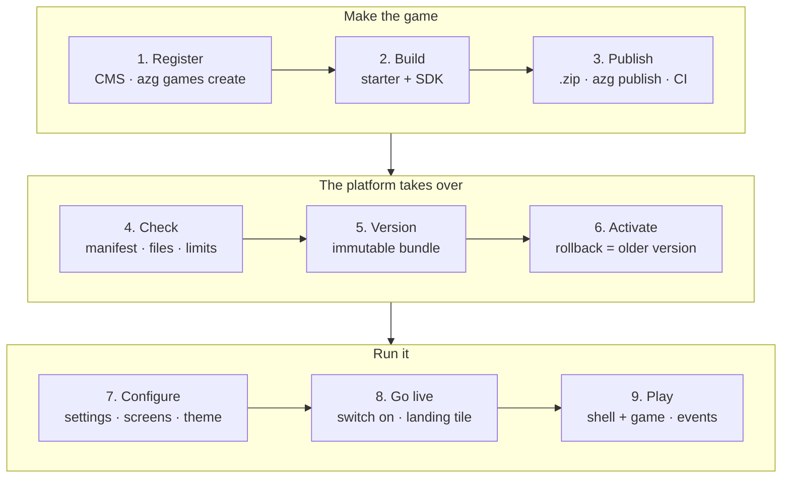
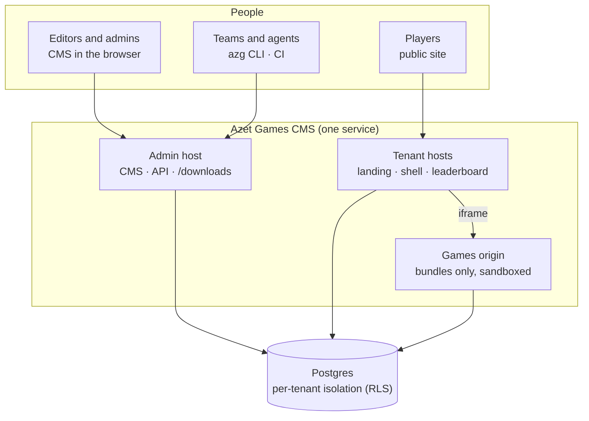

# How Azet Games works

Azet Games CMS is the platform Azet games plug into. A game is a small web page; the platform hosts it, wraps it in a shared **shell** (loading, start and end screens, login, points, streaks, leaderboard) and lets editors configure it without touching code.

This page is the map. Every other document goes deeper into one part.

## The flow of a game

| Step | What happens | Who | Read more |
|---|---|---|---|
| 1. Register | The game gets a slug, a draft record in the tenant and a deploy token; the CLI creates a folder from the chosen template (a GitLab repo only where the CMS has GitLab configured). | Team, editor, agent | [Hackathon guide](hackathon.md), [CLI](cli.md) |
| 2. Build | Start from a template (`html` without a build, or Vite + TypeScript/React/Phaser/Pixi). The game talks to the shell through `@azet/games-sdk`. | Team (an AI assistant can help) | [SDK contract](sdk-contract.md), [Manifest](manifest.md) |
| 3. Publish | One result either way: upload a .zip in the CMS or run `azg publish` (on the hackathon from your laptop on the VPN; CI there only builds backend images). | Team, CI | [API](api.md) |
| 4. Check | The CMS validates `azet-game.yaml` against the schema, checks that the id matches the game, that the entry file and icon exist, and the size limit. | CMS | [Manifest](manifest.md) |
| 5. Version | The files become an immutable version under `/<tenant>/<slug>/<version>/` on the separate games origin. | CMS | [Architecture](architecture.md) |
| 6. Activate | One version is active. Rolling back is activating an older one. Deploy tokens never activate in production tenants. | Editor, team in sandbox | [API](api.md) |
| 7. Configure | Settings declared in the manifest appear as a form; texts of the start and end screens, motivation and the game accent are edited live with a preview. | Editor | [PRD](prd.md) |
| 8. Go live | Status `Live` (on) or `Off`; tiles on the tenant landing page; promotion from the hackathon tenant to Azet or Koktejl as a draft. | Editor | [PRD](prd.md) |
| 9. Play | The player opens the game on the tenant's public host. The shell loads the game in a sandboxed frame, starts a play session, counts the result and records events. | Player | [SDK contract](sdk-contract.md) |

## The parts

- **Tenants** separate sites: `azet-hackathon` (sandbox), `azet` and `koktejl` (production). Data never crosses tenants; in production, agent changes wait for a person to approve them.
- **Three hosts**: the admin host (CMS, API, CLI downloads), one public host per tenant, and the games origin that only serves game files. Games run sandboxed on their own origin and cannot read cookies of the CMS.
- **Shell and SDK**: the shell does everything around the game; the game only plays and reports `complete({ score })`. The protocol is frozen from 23 October 2026 and only grows in compatible ways.
- **CLI `azg`**: everything the CMS does, from the terminal, for people and agents. It is installed from the CMS itself.

## Documents

| Group | Document | For |
|---|---|---|
| Start here | Overview (this page) | Everyone |
| | [Hackathon guide](hackathon.md) | Teams: from zero to a live game, with and without programming |
| | [What you can use](capabilities.md) | Teams: every platform feature with its status today, how to use it and its limits |
| Building games | [SDK contract](sdk-contract.md) | The game ↔ shell protocol, limits, error codes |
| | [Game services](game-services.md) | Player, points, boards, cloud save, currency, tournaments, multiplayer from a game and its backend |
| | [Manifest](manifest.md) | `azet-game.yaml`: settings, scoring, assets |
| | [CLI](cli.md) | Every `azg` command and exit code |
| Reference | [API](api.md) | REST endpoints, scopes, upload, downloads |
| Platform | [Architecture](architecture.md) | Components, data model, security |
| | [Deploy](deploy.md) | Hosts, Helm chart, Vault, CI |
| | [Engineering](engineering.md) | Code standards and quality gates |
| Product | [PRD](prd.md) | Requirements and acceptance criteria |
| | [Decisions](decisions.md) | Why things are the way they are |
| | [Build plan](build-plan.md) | Phases, status, human prerequisites |
